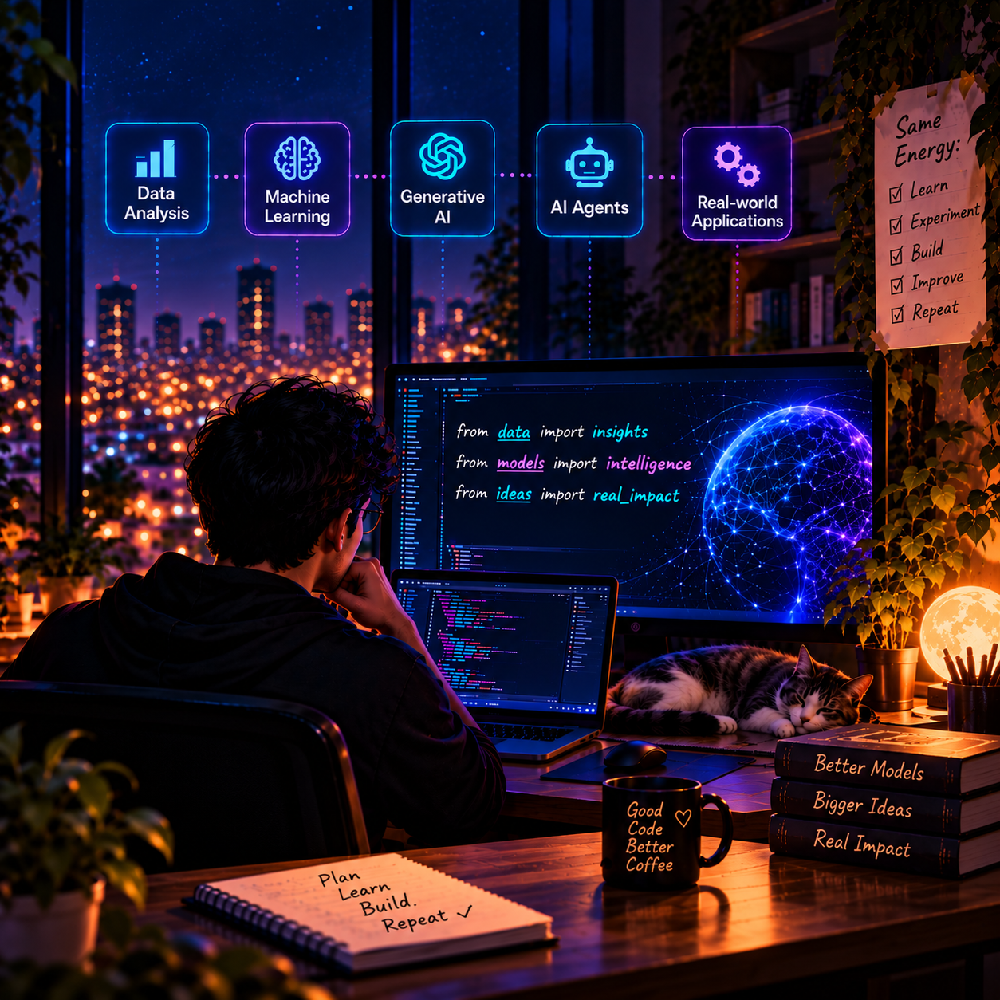
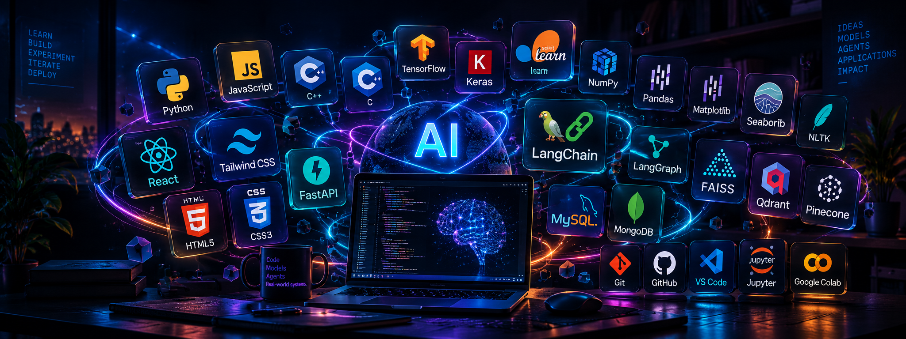

<h1 align="center">Hi , I'm Lalit Chandra</h1>

<h4 align="left">
  <a href="https://git.io/typing-svg">
    
  </a>
</h4>

<p align="left">
  <b>Aspiring AI/ML Engineer · Agentic AI Explorer · AI Systems Builder</b>
</p>

<p align="left">
  
</p>

---

## 📃 About Me

<div>
  

I'm a B.Tech Information Technology student passionate about building intelligent systems and real-world applications. I enjoy exploring how machines learn, how language models process information, and how AI agents can perform tasks and interact with tools.

My interests lie at the intersection of **Data Analysis Machine Learning, Generative AI, and Agentic AI**. I like experimenting with new technologies, understanding the engineering behind AI systems, and turning ideas into practical projects rather than limiting myself to theory.

- 💼 Experience as an AI/ML Trainee at BSP, SAIL India, and a Frontend Developer Intern at Walsoul Consulting
- 🚀 My goal is to build useful AI products that combine intelligent models with thoughtful engineering and deliver measurable real-world impact
- 🧠 Exploring Machine Learning, Deep Learning, Generative AI, and Large Language Models along with frameworks and technologies such as LangChain, LangGraph, FastAPI, and Hugging Face
- 🔎 Building Retrieval-Augmented Generation (RAG) pipelines using embeddings, vector databases, and semantic search
- ⚙️ Interested in LLM application engineering, intelligent automation, and context-aware systems
- 📊 Enjoy working with data, extracting meaningful insights, experimenting with models, and evaluating their performance
- 📫 Reach me at [mail4lalitchandra@gmail.com](mailto:mail4lalitchandra@gmail.com)

</div>
</div>

---

# ⚙️ My Engineering Arsenal

<p align="left">
  

  
</p>

### Programming Languages
`Python` · `JavaScript` · `C` · `C++` · `SQL`

### Web Development
`HTML` · `CSS` · `React.js` · `Tailwind CSS` · `FastAPI`

### AI, Machine Learning & Data Science
`Deep Learning` · `Generative AI` · `TensorFlow` · `Keras` · `Scikit-learn` · `NumPy` · `Pandas` · `Matplotlib` · `Seaborn` · `NLTK`

### LLM Engineering & Agentic AI
`LangChain` · `RAG` · `Embeddings` · `Semantic Search`

**Currently Exploring:** `LangGraph` · `Agentic Workflows` · `Tool Calling`

### Databases & Vector Search
`MySQL` · `MongoDB` · `FAISS` · `Qdrant` · `Pinecone`

### Developer Tools
`Git` · `GitHub` · `VS Code` · `Jupyter Notebook` · `Google Colab`

---

# 🧠Featured Projects

## ⚡ MemoLM

**Intelligent LLM Response Firewall & Safe Semantic Cache Gateway**

A safety-aware semantic caching gateway designed to reuse relevant LLM responses while rejecting unsafe or outdated cache matches.

- Evaluates knowledge versions, TTL, domain risk policies, and tenant isolation.
- Provides an OpenAI-compatible gateway for cached responses and provider fallback.
- Includes cache explainability, latency and cost tracking, and an interactive playground.
- Provides Python SDK integration and Python/TypeScript SDK documentation.

**Focus:** LLM Infrastructure · Semantic Caching · AI Safety · Backend Engineering

[View Repository →](https://github.com/lalitchandra00/MemoLM)

## 🎬 VidzyAI

**AI-Powered Video Understanding**

An AI project focused on making video content easier to explore and query.

- Explore AI-assisted youtube video summarization and information retrieval.
- Designed around making information from video content more accessible.
- Extended AI Capabilities Through a Browser Extension

**Focus:** Generative AI · Natural Language Processing · Information Retrieval

[View Repository →](https://github.com/lalitchandra00/VidzyAI)

## 🌊 OceanSentinal

**AI-Powered Marine Debris & Sonar Image Analysis**

A computer-vision project focused on detecting underwater objects and marine debris from side-scan sonar imagery.

- Uses YOLO-based object detection for sonar image analysis.
- Focuses on identifying marine debris and underwater anomalies.
- Connects AI detection with sonar preprocessing and a geospatial analysis workflow.

**Focus:** Deep Learning · Computer Vision · YOLOv8 · Sonar Image Analysis

[View Repository →](https://github.com/lalitchandra00/OceanSentinal)

---

# 💻GitHub Analytics

<p align="left">
  
  
</p>


# Currently Exploring

```text
AI SYSTEMS     → LLM applications, RAG, semantic retrieval
AGENTIC AI     → LangGraph, tool calling, multi-step workflows
ML ENGINEERING → Deep Learning, model evaluation, computer vision
SOFTWARE       → API design, backend systems, full-stack integration
```

I want to understand not only how to build intelligent models, but also how to turn them into useful, reliable software.
<br>


<p align="center">
  <a href="mailto:mail4lalitchandra@gmail.com">
    
  </a>
  <a href="https://www.instagram.com/lalittchandra" target="_blank">
    
  </a>
  <a href="https://www.linkedin.com/in/lalit-chandra-b943b7317" target="_blank">
    
  </a>

  
</p>
<p align="center">
  <i>Code. Models. Agents. Real-world systems.</i>
</p>
